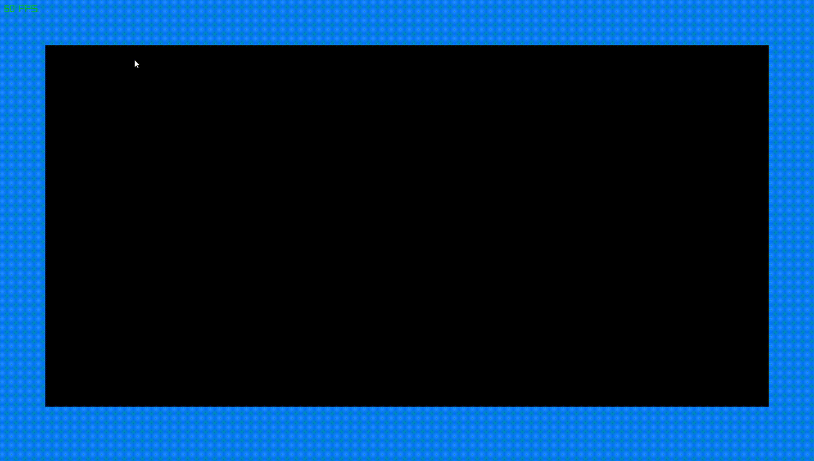

# 2D Fizik Motoru (Raylib)
C++ ile yazılmış, öğrenme amaçlı 2d bir fizik motoru



## Özellikler
- Dışbükey çokgenlerde çarpışma 
- AABB ve SAT ile çarpışma kontrolü
- Sürtünme ve Esneklik
- Spatial Hashing
- Yarı örtük euler entegrasyonu

## Derleme
**Gereksinimler:** C++17, Raylib
```bash
git clone https://github.com/zefyrn/raylib-physics
cd raylib-physics
cmake -B build
cmake --build build --config Release
build\Release\physics.exe
```
Sadece Windows'ta test edildi

## Eksikler
- Sürükleme gibi nesne kontrolleri
- Zoom, WASD gibi kamera hareketleri
- Motor çalışırken şekil seçme
- R ile sıfırlama 


## Kontroller
Sol tık: main.cpp'de belirtilen genişlikte ve yükseklikte bir dörtgen oluşturur. Oluşturulan nesne başlangıç hızı olarak mouse'un hızını alır

## Notlar
- createBody() kütleyi ters kütle olarak alır bir cismi daha ağır yapmak istiyorsanız 0'a yaklaştırın
- createBody()'de genişlik ve yükseklik yarım ölçüdür
- Duvarları kaldırmak istiyorsanız main.cpp'de ana döngüden önceki 3 createBody çağrısını silin

## Step Akışı
1. Kuvvetler uygulanır, hız ve konumlar güncellenir
2. Spatial hash ile grid oluşturulur
3. 32 iterasyon boyunca çarpışmalar önce AABB sonra SAT ile tespit edilir ve çözümlenir

## Bilinen Sorunlar
- Titreme
- Zaman adımı sabit değil
- Nesne sürükleme, kamera kontrolü ve şekil oluşturma ekranı yok

## Lisans
MIT
